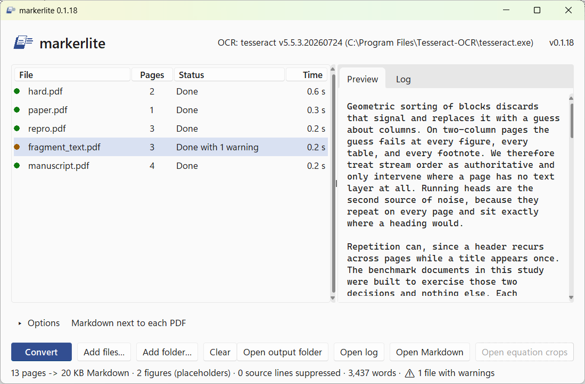

# markerlite — Marker's document understanding, without the weights

[](https://github.com/GalBlatman/markerlite/releases/latest)
[](https://github.com/GalBlatman/markerlite/actions/workflows/build-windows.yml)
[](LICENSE)

[Marker](https://github.com/datalab-to/marker) needs downloaded model weights
for five of its stages. markerlite is a reimplementation of the parts that
don't, plus weight-free substitutes for the parts that do.

Conversion runs offline, on CPU, with no model downloads.

The app’s only network request is the user-initiated **Help → Check for updates**: one HTTPS GET to GitHub’s latest-release API with a 10-second timeout. There are no automatic or startup checks, polling, or document uploads. Help links open your default browser through the OS.

**Windows:** download `markerlite-windows.zip` from the
[latest release](https://github.com/GalBlatman/markerlite/releases/latest),
unzip, run `markerlite.exe`. Drag PDFs in, get Markdown out. Everything else —
source install, command line, what it gets right and wrong — is below.

## What it is genuinely good at

- **Reading order on multi-column pages.** This is the main reason it exists.
  Marker orders text-layer pages by PDF character-stream position rather than by
  its learned reading-order head; the same signal is available from PyMuPDF, and
  it is what keeps a two-column journal article from interleaving its columns.
- **Running headers, footers and page numbers**, suppressed on evidence of
  repetition across pages rather than on position alone. The repeated line
  must also sit in the same place and, on digital pages, in the same type
  size, so a journal name in an article's own citation block survives.
- **Paragraph flow** — text rejoined across line, column and page breaks, with
  hyphenation undone. A dash between two numbers is kept: a page range broken
  after "3370-" comes out as "3370-3381".
- **Headings**, with levels taken from section numbering when the document
  numbers its sections, and from font-size clustering otherwise.
- **Lists**, including nesting depth from indentation.
- **Footnotes**, as labeled definitions (`[^1]: ...`) with the in-text
  superscript emitted as the matching reference (`[^1]`). Notes wrapped across
  lines or blocks are merged; a superscript with no matching note (an exponent)
  is left as `<sup>`.

That set is reliable. What follows is not, and is described honestly because
the failure modes are quiet ones.

## What is partial

**Tables.** Grids are **off by default**. Detected table regions are kept
as ordered source prose under a `<!-- table p. N: grids disabled; text kept
as prose -->` marker. The text is retained; the layout is lost. A marker
means the detector found a candidate, not proof that it is a table.

Use `--grids` (or `convert(..., grids=True)`) to opt into grids. In a frozen
held-out sample from the author's own Zotero library, only **2 of 60 emitted
grids were correct** (3.3%; 95% interval 0.9–11.4%), both before and after
the targeted repairs. Most wrong grids had row, column, header or extent
errors, or were not tables. This measurement describes that library, not a
universal benchmark. Details: [the release-candidate report](tests/REPORT-v0.2.0-rc.md).

Opt-in grids carry a comment naming their evidence (ruling lines or aligned
text), with "verify before use". The label is evidence, not confidence.
If reconstruction or the guard fails, the region stays prose under its
"reconstruction failed" marker. **Verify any table you intend to read as
data.** The GUI has a per-run Table grids option and a saved Preferences
default; both start off for new or migrated settings.

**Figures.** markerlite does not read figures; it hands them to something that
can. Every figure it finds leaves a placeholder at its position in the text,
`<!-- figure: p. N; caption: ... -->`, whether or not images are saved, so a
sentence that says "as Figure 2 shows" points at something. Embedded raster
images are found reliably. Vector drawings — plotted charts, diagrams,
flowcharts — are detected heuristically by clustering path operators, which
works on typical charts but will miss some and occasionally capture something
that isn't a figure. A figure inside a scanned page is known from its caption
only: it gets a placeholder and no image. `--flag-figures` crops each figure
for a vision model and `--apply-figures` puts the descriptions back, marked as
not the authors' text.

**Equations.** markerlite does **not** convert formulas. The `$$` blocks hold a
text-layer approximation — the glyphs in reading order, not LaTeX. What it does
is find equation regions and crop them (`--flag-math`), so a vision model can
transcribe them; `--apply-math` splices the results back in. Detection uses
glyph content, equation numbering and display placement, so it catches
Symbol+Times equations that font-name matching misses, but it is not exhaustive.

**Scanned PDFs** are detected automatically and OCR'd through Tesseract, using
its own page segmentation so two-column scans keep their columns. This includes
aggregator scans (ProQuest, ResearchGate) that carry a one-line copyright stamp
on every page: the stamp used to count as "text" and such files converted to
nothing. If a document is image-only and Tesseract is missing, the summary says
so instead of staying silent. The output inherits Tesseract's errors — large
display type is sometimes misread, and a page number can land mid-text — so it
is readable, not clean.

**Provenance pages.** A JSTOR terms page, a ResearchGate cover, or a ProQuest
citation banner is recognised by its boilerplate and left out of the body; the
citation it carried (title, source line, DOI or Stable URL) is written as an
HTML comment at the top of the Markdown, so the origin is not lost.

**Warnings.** The summary line, the app's file list and the run log say when
a document needs a look; nothing is removed to produce a warning. Besides
lossy, low-yield and garbled pages, a page whose text comes out mostly in one-
and two-letter pieces is reported as a fragment page (typically a sideways
scanned table read from a hidden OCR layer; its word count looks normal). A
malformed or hostile PDF can no longer stall a batch or exhaust memory: table
geometry, drawings, image sizes and OCR are bounded well above anything seen
in real documents, and a document that reaches a bound keeps its content and
reports "resource limit reached" with the details in the stats.

**Heading recovery on real journal articles** is decent but not complete. A
document that styles every heading identically, with no numbering, gives the
classifier little to work with, and some headings will come through as ordinary
paragraphs.

## What it will not do

Inline math inside a paragraph is not detected at all. Marker needs an LLM for
that too — its `line_merge.py` is a no-op unless `use_llm` is set.

## Get it

Two ways in. Pick whichever fits.

### A. The Windows app — no Python, no terminal

Download `markerlite-windows.zip` from the
[Releases page](https://github.com/GalBlatman/markerlite/releases/latest),
unzip it, open the `markerlite` folder and run **`markerlite.exe`**. Keep the
folder together — the files beside the exe are part of the program.

The first time, Windows SmartScreen will show a blue *"Windows protected your
PC"* dialog. That is what every unsigned program from a new publisher gets; it
is not a detection. Click **More info**, then **Run anyway**. It asks once.

The app does not include Tesseract, so scanned PDFs (no text layer) will fail
with a clear message. Digital PDFs — nearly everything from a publisher — work
without it. To add scanned support, install the
[UB-Mannheim Tesseract build](https://github.com/UB-Mannheim/tesseract/wiki).
markerlite checks `TESSERACT_CMD`, then `PATH`, the Windows installer registry
keys, and the usual Program Files and LocalAppData install directories. The
default UB-Mannheim installation therefore works without changing `PATH`.

### B. From source — any OS, and no SmartScreen prompt

Nothing is unsigned here because you run the code with your own Python.

```bash
python -m pip install -e .
python -m pip install -e ".[gui]"  # optional: drag-and-drop in the GUI
# optional, for scanned PDFs:
#   apt install tesseract-ocr      (Linux / WSL)
#   brew install tesseract         (macOS)
#   UB-Mannheim installer          (Windows)
```

Then either launch the same GUI the app provides:

```bash
python markerlite_gui.py
```

or use the command line, below.

## Pin markerlite in a pipeline

For v0.2.1 and later, install the hash-checked bootstrap and dependency lock
from the same tag, then install that exact source without resolving new
dependencies or creating an unpinned build environment. `pyproject.toml`
keeps compatible ranges for ordinary installs.

```bash
TAG=v0.2.1 # once published; use an exact verified commit before tagging
curl -O "https://raw.githubusercontent.com/GalBlatman/markerlite/${TAG}/requirements-bootstrap.txt"
curl -O "https://raw.githubusercontent.com/GalBlatman/markerlite/${TAG}/requirements-lock.txt"
python -m pip install --require-hashes --only-binary=:all: -r requirements-bootstrap.txt
python -m pip install --require-hashes --only-binary=:all: -r requirements-lock.txt
python -m pip install --no-deps --no-build-isolation \
  "markerlite @ git+https://github.com/GalBlatman/markerlite.git@${TAG}"
markerlite --version
```

The lock includes the build/test dependencies and platform-specific wheel
hashes. To regenerate it deliberately, use `uv pip compile
requirements-lock.txt --generate-hashes --universal --python-version 3.12
--no-annotate --output-file requirements-lock.txt` and review the diff.

Record the tag or commit and keep the generated Markdown and stats hashes with
the pipeline run. Upgrade deliberately and compare those hashes on a sample
before processing the full corpus again.

## Use

### The app



Drop PDFs onto the window — files, or a folder to take every PDF in it — and
click **Convert**. Output goes next to each PDF by default, or to one folder you
pick. The checkboxes are the command-line flags: extract images, crop equations,
insert page markers. The preview pane shows the Markdown of whichever file is
selected; read it before trusting a document, because the table and heading
defects described above are quiet. **Open Markdown** and **Open output folder**
do what they say. Each file's row shows its pages, its status (Queued,
Converting with a percentage, Done, Done with N warnings, Failed, Cancelled)
and how long it took; click "Done with N warnings" to read them, and hover
over a row for its word, OCR and table counts. When a batch finishes, the
status line reports it as
`17 pages → 76 KB Markdown · 3 figures · 2 equation crops`. The version is in
the window title and at the top right; click it to copy the markerlite,
Tesseract and Windows versions for a bug report. The window follows the
Windows light or dark app setting.

While a batch runs, **Convert** becomes **Cancel** (Esc does the same). The
file being converted is abandoned and leaves nothing behind, files already
converted stay, and the rest are skipped; the run log says which. Cancel
takes effect between pages, usually within a second; a long whole-document
step can hold it for a few seconds (the worst measured was 6.6 s).

File provides Open PDFs (Ctrl+O), Open folder and recent files. Tools →
Preferences holds output, OCR, Explorer, appearance and table-grid defaults;
Options holds per-batch choices. Help → Check for updates runs only when
you request it.

Right-click a file for Open Markdown, Open PDF, Show in folder, Copy
Markdown, Show warnings (that file's lossy pages, fragment pages, tables
kept as prose and resource limits), Re-convert and Remove from list. Entries
that do not apply are greyed out, and Remove only takes the file off the
list. The preview pane has Copy and Select all.

Output is written whole or not at all: each file is written under a
`.part` name and renamed into place only when the conversion succeeds, so a
failed or cancelled conversion never replaces a good earlier result with
half a file. The same holds on the command line, where Ctrl+C cancels.

**Send to.** In Tools → Preferences → Explorer integration, tick
*Add markerlite to Explorer's Send to menu*. Then select PDFs in Explorer, right-click, *Send to* → *markerlite*:
they are added to the list and, by default, converted with the current settings.
Preferences can turn automatic conversion off. If
markerlite is already open they go to that window (queued behind a batch
that is running); anything that is not a PDF is skipped and noted in
`%LOCALAPPDATA%\markerlite\markerlite-app.log`. The option is a shortcut in
your own Send to folder, nothing else: no registry change, no administrator
rights. If you move the markerlite folder, the next start points the
shortcut at the new place. **Untick the option before deleting the
markerlite folder**, or the menu keeps an entry that leads nowhere.

**Troubleshooting.** `markerlite.exe --diag` writes `markerlite-diag.txt`
beside the exe: the version, Tesseract, drag-and-drop and the theme that
loaded. Attach it to a bug report. The window picks light or dark from the
Windows setting when it starts; to force one, set the environment variable
`MARKERLITE_THEME` to `light` or `dark` before starting it (for example
`set MARKERLITE_THEME=dark` and then `markerlite.exe` in the same Command
Prompt).

### The command line

```bash
markerlite paper.pdf -o md_out
python3 markerlite.py paper.pdf -o md_out
python3 markerlite.py *.pdf -o md_out --images --page-markers
python3 markerlite.py paper.pdf -o md_out --flag-math
python3 markerlite.py --apply-math md_out/paper_math.json -o md_out
python3 markerlite.py paper.pdf -o md_out --flag-figures
python3 markerlite.py --apply-figures md_out/paper_figures.json -o md_out
```

| Flag | Effect |
| --- | --- |
| `-o DIR` | output directory (default `md_out`) |
| `--images` | extract figures (rasters and vector drawings) and link them |
| `--flag-math` | crop equation regions and write a JSON manifest |
| `--apply-math J` | splice transcribed LaTeX from a filled manifest into the `.md` |
| `--flag-figures` | crop every figure at 200 dpi to `<stem>_figures/` and write `<stem>_figures.json` |
| `--apply-figures J` | put the descriptions from a filled figure manifest under their placeholders |
| `--grids` / `--no-grids` | opt into table grids / keep source prose (default); verify grids before use |
| `--page-markers` | emit `<!-- page N -->` at each page boundary |

Page markers cost almost nothing in context and let you ask an LLM where in the
source PDF something appeared.
OCR pages always carry `<!-- ocr page N -->`, even without `--page-markers`,
so you can distinguish recognized text from the PDF's original text layer.

**Figures: crop, describe, splice.** markerlite does not read figures; it hands
them to something that can. `--flag-figures` writes one PNG per figure and a
manifest with one entry per placeholder: `id`, `page`, `bbox`, `caption`,
`file` and an empty `description`. Fill in the descriptions, by hand or by
giving the crops to any vision model, and run `--apply-figures` on the
manifest. Each description is inserted under its figure's placeholder as a
block quote that opens with `<!-- figure description: model-transcribed -->`,
so it cannot be mistaken for something the authors wrote. Entries left empty
are skipped, and applying a manifest twice gives the same file. A figure on a
scanned page has an entry with no file, because there is no region to crop.
An equation that the document sets as a picture is not a figure: it goes
through `--flag-math`. With `--images` as well, the Markdown links to the same
crops and nothing is saved twice. The app does not offer these two flags yet.

`INSTALL.md` walks through the WSL setup; `WINDOWS-GUI.md` covers the native
Windows install, the launcher, and building the exe yourself.

## Python API

```python
import sys, pathlib
sys.path.insert(0, "/path/to/markerlite")   # it does `from table_recon import ...`
from markerlite import convert, summarize

pathlib.Path("outdir").mkdir(exist_ok=True)
out_path, info = convert(pathlib.Path("in.pdf"), pathlib.Path("outdir"),
                         images=False, do_flag_math=False, page_markers=False,
                         do_flag_figures=False, grids=False)
print(summarize(info["stats"]))
# 17 pages → 76 KB Markdown · 3 figures · 2 equation crops
```

## Two bugs found in Marker's own code

1. `sectionheader.py` sorts its `(height, cluster)` array with
   `np.sort(..., axis=0)`, which sorts the two columns independently and
   scrambles the value→cluster pairing, permuting heading levels.
2. KMeans is asked for four clusters regardless of how many distinct heading
   sizes exist, so it splits one size and invents a level.

Both are fixed in markerlite.

## Security

markerlite treats every PDF as untrusted input. How to report a vulnerability,
and what is in scope, is in [SECURITY.md](SECURITY.md).

## License

Apache-2.0 — see `LICENSE`. `table_recon.py` is vendored from
[Marker](https://github.com/datalab-to/marker), also Apache-2.0; its license
text is kept in `third_party/marker/LICENSE` and the attribution in `NOTICE`.
One license covers the whole repository.

## Performance

~1–2s per page for digital PDFs, ~15s per page for scanned ones.
